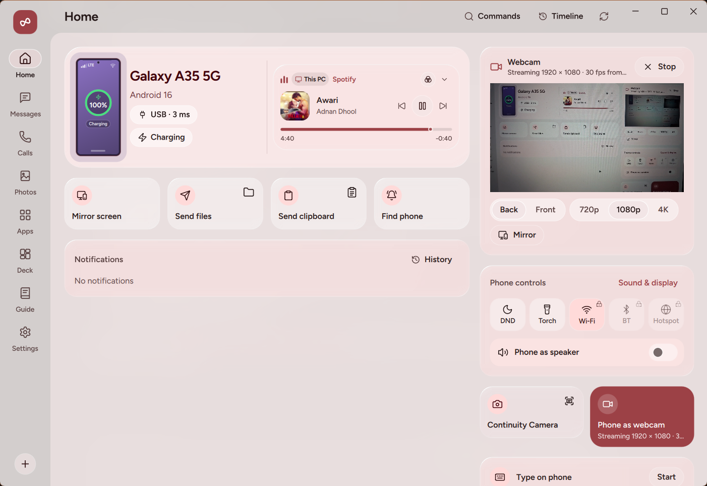
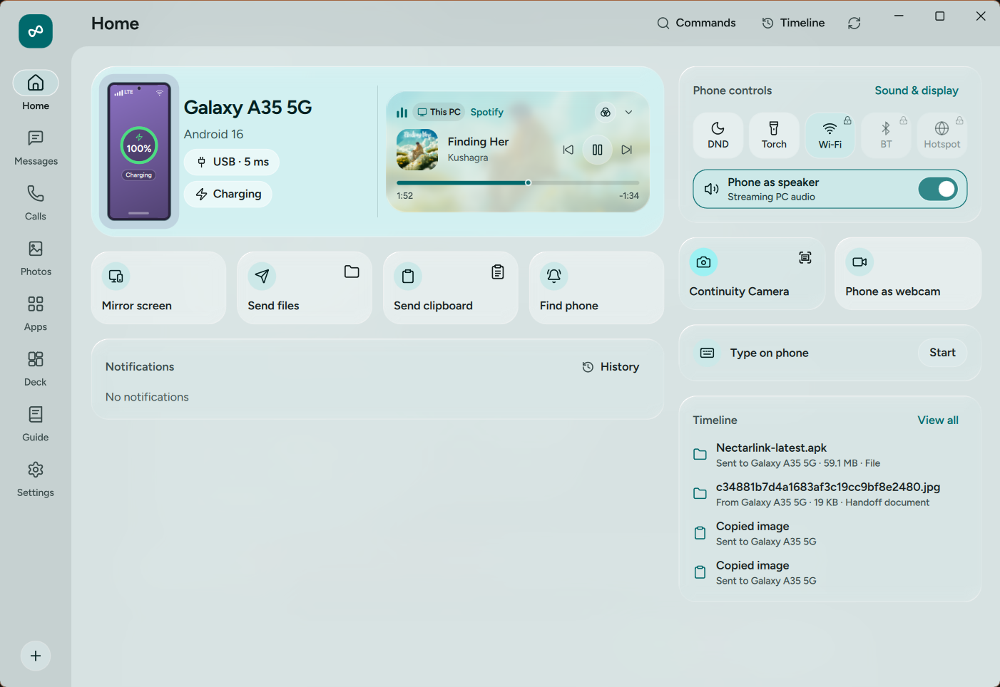

# Cameras and Audio

G7 Link lets your PC use your phone's cameras and audio hardware in four ways: streaming your phone's camera as a webcam on your PC (`G7 Link Webcam`), snapping photos or scanning documents straight into your PC clipboard (**Continuity Camera**), playing your PC's system audio through your phone (**Phone as speaker**), and recording voice notes on your phone that land automatically on your PC (**Voice recorder**).

  

## What You Need

| Feature | Requirements |
| :--- | :--- |
| **Phone as webcam** | `Standard` power level. Android **Camera** permission (`CAMERA`, requested when you start the webcam). **Webcam** per-device toggle enabled in PC **Settings › Devices** (on by default). To use the camera inside other apps (Zoom, Meet, Discord, OBS, your browser), the `v4l2loopback` driver must be installed and loaded. The one-command install does this; otherwise click **Set up** next to **Virtual camera add-on** in PC **Settings › Camera & Audio** (one-time administrator password prompt). |
| **Continuity Camera (Take photo / Scan document)** | `Standard` power level. Android **Camera** permission. **Webcam** toggle enabled. |
| **Phone as speaker (Stream PC audio to phone)** | `Standard` power level. **Media controls** per-device toggle enabled in PC **Settings › Devices** (on by default). |
| **Voice recorder** | `Standard` power level. Android **Microphone** permission (`RECORD_AUDIO`, requested when you start recording). **Voice recordings** per-device toggle enabled in PC **Settings › Devices** (on by default). |

## Step-by-Step Use

### 1. Using Your Phone as a Webcam

Your phone's main camera sensor offers much better optics and low-light quality than a typical built-in laptop webcam.

#### One-Time Virtual Camera Add-On Setup

You can preview your phone's camera inside G7 Link's **Settings › Camera & Audio** immediately with zero setup. To make **G7 Link Webcam** appear as a selectable camera inside Zoom, Google Meet, Discord, OBS Studio, and other apps, G7 Link needs the `v4l2loopback` kernel driver. The one-command install sets it up. If you installed another way:

1. Install your distribution's `v4l2loopback` package (on Fedora it comes from RPM Fusion).
2. On your PC, open **Settings › Camera & Audio**.
3. Next to **Virtual camera add-on**, click **Set up** and enter your password when asked (through Polkit).
4. G7 Link loads `v4l2loopback` as **G7 Link Webcam** and sets it to load at every start. Once it's loaded, the status indicator shows **Ready** (and you can remove it at any time by clicking **Remove**).

With Secure Boot on, the driver's signing key may need to be enrolled before the kernel loads it. The **Connection Doctor** says what's missing.

#### Starting and Controlling the Webcam Stream

1. Start the webcam from either side:
   - **From your phone**: Tap **Webcam** on the Android Home screen and tap **Start webcam**.
   - **From your PC**: Open **Settings › Camera & Audio** (or click the webcam control on Home) and click **Start webcam**. For your privacy, **starting the webcam from the PC posts a confirmation request on your phone** (`<PC> wants to use your camera`) so your phone's camera never opens without your consent on the phone. To skip the tap for a PC you trust, turn on **Start the camera and microphone without asking** under that PC in the phone's **Settings › PCs** (`Elevated`; off by default). Its webcam and microphone requests then start right away, even with the phone locked, and the **Stop** notification and Android's camera dot still show.
2. While streaming, you can adjust the camera from either your phone or your PC:
   - **Camera lens**: Switch between **Back** and **Front** cameras.
   - **Resolution**: Choose **720p** (`1280 x 720`), **1080p** (`1920 x 1080`), or **4K** (`3840 x 2160` on phones whose camera sensor supports 4K at 30 fps).
   - **Zoom**: Tap `1x` or `2x` presets or drag the continuous zoom slider on your phone.
   - **Flashlight (Torch)**: Toggle the rear LED flash on or off for fill lighting.
   - **Mirror image**: Horizontally flip the video feed in PC **Settings › Camera & Audio**.
3. Open your video conferencing app and select **G7 Link Webcam** as your camera.

### 2. Continuity Camera: Take a Photo or Scan a Document

When you need to insert a photo of a physical object, whiteboard, or multi-corner receipt straight into a document on your PC:

1. On your PC, trigger Continuity Camera in any of three ways:
   - Press the global keyboard shortcut: **`Ctrl+Alt+C`** for **Take photo** or **`Ctrl+Alt+D`** for **Scan document** (both shortcuts are customizable in **Settings › Shortcuts & Rules**).
   - Open the `Command Palette` (`Ctrl+Alt+Space`) and choose **Take photo with phone** or **Scan document with phone**.
   - Click **Take photo** or **Scan document** from the Home screen or `Shelf`.
2. Your phone receives a camera capture prompt (`<PC> wants to take a photo` or `<PC> wants to scan a document`). Tap the notification to open the capture screen.
3. **In Photo mode**: Frame your shot, tap **Capture photo**, inspect the preview, and tap **Use photo** (or **Retake**).
4. **In Scan mode**:
   - Capture the page or receipt.
   - Drag the four corner handles (**Adjust corners**) to match the edges of the document. G7 Link corrects the perspective geometry into a flat rectangle.
   - Toggle **Enhance document** to apply high-contrast black-and-white document enhancement for crisp, readable text.
   - Tap **Send scan**.
5. The captured photo or enhanced scan arrives on your PC in `~/Downloads/G7Link` and is automatically placed onto your clipboard so you can press `Ctrl+V` straight into a document, chat, email, or any image editor.

### 3. Phone as Speaker: Listening to PC Audio on Your Phone

If your desktop PC lacks speakers, or you want to walk around the room while listening to your PC's music, video, or call audio through headphones plugged into your phone:

  

1. Toggle **Phone as speaker** on from either side:
   - **On your PC**: Click **Phone as speaker** on the Home screen, or turn on **Stream PC audio to phone** in **Settings › Camera & Audio**.
   - **On your phone**: Tap **Use phone as speaker** in the **PC audio** card on the Android Home screen.
2. Both switches stay synchronized in real time. Your PC captures system playback from the default output's monitor source (PipeWire or PulseAudio) and streams it as uncompressed 16-bit PCM in small QUIC datagrams. The phone plays it through a regular media `AudioTrack`, so its own speaker tuning and sound effects still apply, and keeps about 40 ms buffered to absorb Wi-Fi jitter.
   - Audio goes to the phone that turned **Use phone as speaker** on. When you turn it on from the PC, it goes to the first connected phone.
3. From the **PC audio** card on your phone (or in `Deck`), you can also adjust your PC's master volume slider, toggle mute, and switch between your PC's connected audio output devices.

#### The other way: your phone's sound on the PC

To hear what your phone plays (music, videos, app sounds) through your PC's speakers or headphones without opening a mirror window, turn on **Phone sound on this PC** on the PC's Home screen.

- If several phones are connected, select the phone’s tab on Home first. The switch shows and controls that phone’s sound. Turning it on for another phone stops the previous phone’s sound.
- With `Elevated` it starts right away. Otherwise your phone asks first, as it does for mirroring: tap the notification, then allow it. Android's prompt talks about sharing your screen, but only the sound goes to the PC.
- It's the same sound mirroring sends: on Android 10 and newer, apps that allow their audio to be captured (most media and games). Calls aren't included.
- Your phone goes quiet while its sound plays on the PC. Without `Elevated` it turns its media volume down to 0 and back up when you turn this off (if you turned the volume up yourself meanwhile, yours stays).
- Opening the phone's mirror window takes over, since that brings the sound with the picture. Turn it off on the PC, or tap **Stop** on the phone.

### 4. Voice Recorder: Record on Phone, Save on PC

Use your phone's microphone to record voice notes, interviews, or meeting memos that transfer straight to your PC in the audio format you prefer:

1. On your phone, tap **Record** on the Android Home screen and tap **Start recording**.
2. While recording, a live level meter shows your microphone input, and recording continues cleanly in a foreground service even if you turn your phone's screen off.
3. Tap **Pause** and **Resume** as needed. To flag an important moment while recording, type an optional label and tap **Add marker** to record a timestamped marker.
4. When you finish and tap **Send**:
   - If your PC is online, the recording transfers immediately and lands in your chosen recordings folder (`~/Documents/G7Link Recordings` by default).
   - If you chose **MP3**, **WAV**, or **FLAC** in PC **Settings › Files & Sync › Voice recordings** (instead of the default **M4A**), your PC automatically converts the audio file upon arrival.
   - If you added markers during the recording, G7 Link writes a companion `<filename>.markers.txt` file right beside the audio file listing every marker's timestamp and label.
   - If your PC is offline when you finish recording, the voice note stays saved on your phone and is sent automatically as soon as your PC reconnects.

## What the Options Do

- **Stream PC audio to phone** (`Settings › Camera & Audio` on PC, default: **Off**): Streams your PC's system audio to your connected phone in real time.
- **Pause media during calls** (`Settings › Camera & Audio` on PC, default: **On**): Auto-pauses PC media playback when your phone rings or is in a call.
- **Virtual camera add-on** (`Settings › Camera & Audio` on PC): Loads or removes the `G7 Link Webcam` virtual camera (`v4l2loopback`).
- **Phone** (`Settings › Camera & Audio` on PC, shown when multiple phones are paired): Selects which paired phone is used for the webcam.
- **Camera** (`Settings › Camera & Audio` on PC, default: **Back**): Selects the **Back** or **Front** phone lens.
- **Mirror image** (`Settings › Camera & Audio` on PC, default: **Off**): Flips the webcam video horizontally.
- **Resolution** (`Settings › Camera & Audio` on PC, default: **720p**): Selects **720p**, **1080p**, or **4K** (`2160p`) webcam output.
- **Voice recordings** (`Settings › Files & Sync` on PC, default format: **M4A**): Sets the destination folder (**Choose folder** / **Reset**) and output format (**M4A**, **MP3**, **WAV**, or **FLAC**) for incoming voice recordings.
- **Take photo / Scan document shortcuts** (`Settings › Shortcuts & Rules` on PC, defaults: `Ctrl+Alt+C` and `Ctrl+Alt+D`): Global shortcuts for Continuity Camera (on Wayland, where the desktop offers the Global Shortcuts portal).

## Data and Privacy

- **Explicit camera consent on the phone**: A paired PC can never open your phone's camera unless you allowed it. Whenever you click **Start webcam** or trigger **Continuity Camera** from the PC, your phone displays a notification requiring a physical tap on the phone before the camera opens, unless you turned on **Start the camera and microphone without asking** for that PC (webcam and microphone only). While streaming, Android's green camera privacy indicator and G7 Link's persistent **Streaming camera to `<PC>`** notification remain visible on your phone with a one-tap **Stop** button.
- **Shared memory isolation**: Decoded webcam frames pass through a shared-memory file that only your user can read (`0600`, in `$XDG_RUNTIME_DIR` or `/dev/shm`), with bounds checks (`MAX_WIDTH = 3840`, `MAX_HEIGHT = 2160`), before G7 Link writes them to the `v4l2loopback` device.
- **Temporary camera cache**: Temporary Continuity Camera captures on the phone are stored in the app's private cache and deleted automatically within 24 hours (or immediately via **Settings › Features & Data › Data & storage › Photo thumbnails & camera cache › Clear**).

## Limits

- **4K Webcam Hardware Support**: 4K (`3840 x 2160`) webcam streaming requires a phone camera sensor and hardware encoder that support 4K 30 fps output, plus sufficient Wi-Fi or USB bandwidth. If a phone camera only supports up to 1080p, it streams at its highest supported resolution.
- **8-Bit SDR Webcam Pipeline**: The webcam pipeline uses 8-bit SDR color (YUYV frames on the `v4l2loopback` device) for broad compatibility across video calling apps, browsers, and OBS; 10-bit HDR video is not used.
- **Administrator Prompt for the Virtual Camera**: Loading or removing the `v4l2loopback` driver (**Virtual camera add-on › Set up**) needs your administrator password once. Previewing the webcam inside G7 Link's own window works without it.
- **Continuity Camera Request Expiry**: If you trigger **Take photo** or **Scan document** while your phone is offline, the queued request expires after **2 minutes** so your phone does not unexpectedly prompt for a photo hours later.
