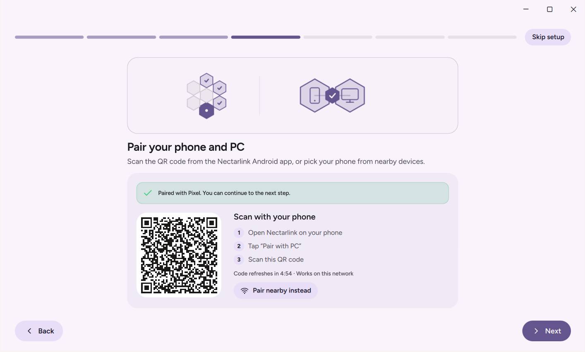
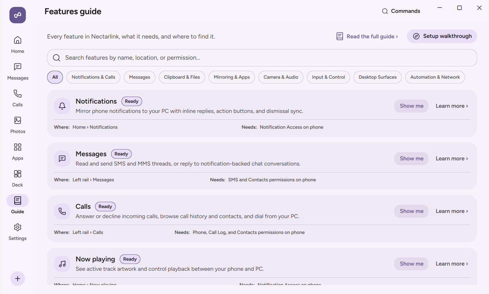
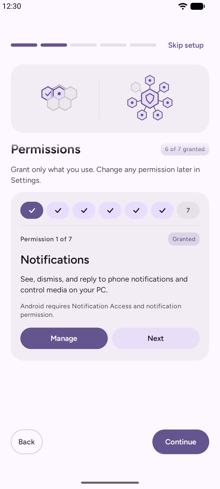
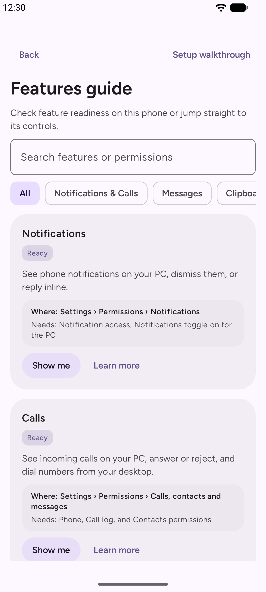
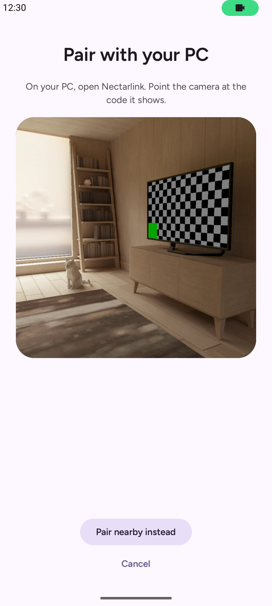
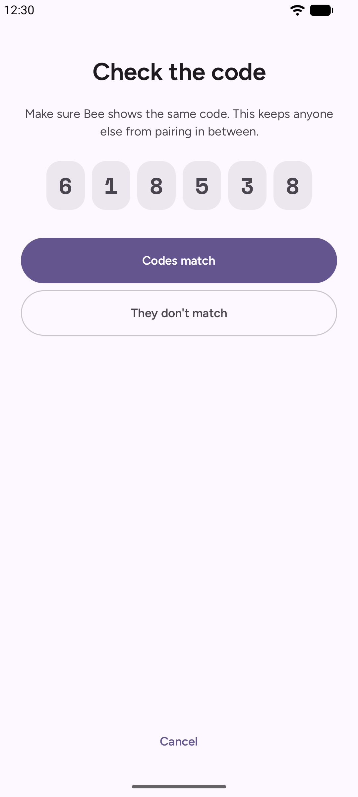
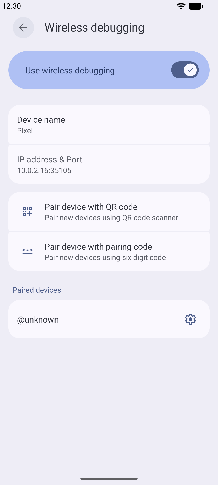

# Getting Started

This guide walks you through installing G7 Link on Linux and Android, completing the first-run setup walkthrough, pairing your devices, and choosing the Android power level that fits how you work.

## System Requirements

| Platform | Minimum Version | Notes |
| :--- | :--- | :--- |
| **Linux PC** | Ubuntu 24.04 or newer, Debian 13, Fedora 40 or newer, or another distribution from 2024 on (glibc 2.39 or newer), 64-bit Intel or AMD | X11 or Wayland. The phone as a webcam needs the `v4l2loopback` driver, which the install command sets up. |
| **Android Phone or Tablet** | Android 8.0 (API 26) or newer | Android 10+ required for internal audio capture during mirroring; Android 11+ required for on-device Wireless Debugging (`Elevated`) and `app window` streaming; Android 12+ required for `Elevated` in-call mute/hold/speaker controls. |
| **Network** | Shared Wi-Fi / LAN, USB cable, or **Connect over mobile data** | By default, all device-to-device traffic travels directly over your local network or a USB data cable without leaving your LAN (installed copies only contact GitHub Releases over HTTPS to check for app updates; see [Privacy and Security](privacy-and-security.md)). |

## Installing G7 Link

### On Linux

Open a terminal and run:

```bash
curl -fsSL https://github.com/Astraque-Softwares-Ltd/g7link/releases/latest/download/install.sh | sh
```

It shows each step as it runs, and `sudo` asks for your password once. It:

1. Checks that your system can run G7 Link.
2. Downloads the package for your system (a `.deb` with apt on Ubuntu and Debian, an `.rpm` with dnf on Fedora or zypper on openSUSE, the tarball elsewhere) and checks it against the release's `SHA256SUMS.txt`. If it doesn't match, nothing is installed.
3. Installs it with the libraries and tools it needs, and adds G7 Link to your app menu.
4. Sets up the phone as a webcam: installs the `v4l2loopback` driver and loads it as **G7 Link Webcam**, now and at every start. On Fedora the driver comes from RPM Fusion, which the installer doesn't add for you; it tells you how. With Secure Boot on, it also tells you how to enroll the driver's key.
5. Lets the phone type and move the pointer: a udev rule gives the signed-in user access to `/dev/uinput`, as game controller drivers do.
6. Opens G7 Link's ports (7718, mDNS on 5353, and LocalSend on 53317) in ufw or firewalld, to your local network only.

To install only the app, end the command with `sh -s -- --no-extras` instead of `sh`. Without `sudo` or `doas`, it installs the tarball in your home folder and skips steps 4 to 6.

You can also download a package from the GitHub Releases page yourself: `g7link_<version>_amd64.deb`, `g7link-<version>-1.x86_64.rpm`, `G7Link-<version>-x86_64.AppImage`, or `G7Link-<version>-linux-x86_64.tar.gz` (run its `install.sh`). The AppImage adds itself to your app menu the first time it runs. **Connection Doctor** in G7 Link's **Settings › Connection & About** finds anything still missing for the webcam, input or firewall and says how to fix it.

Each kind of install updates itself the same way it was installed.

### On Android

1. Download `G7Link-<version>-android.apk` from the GitHub Releases page (or scan the QR code shown in the PC walkthrough).
2. Open the downloaded APK and allow installation if Android prompts you. Because G7 Link supports full SMS/MMS messaging, call logs, notification actions, accessibility input, and optional `All files access` for showing phone storage in your file manager (permissions that Google Play restricts), the full app is distributed directly as a signed APK with built-in SHA-256 verified updates:
   - If Google Play Protect shows an unrecognized-developer prompt, tap **More details › Install anyway**.
   - Where Google Play Protect's **Enhanced Fraud Protection** is on (185 markets, including India), it blocks browser-sideloaded APKs that declare `READ_SMS`, `BIND_NOTIFICATION_LISTENER_SERVICE`, or `BIND_ACCESSIBILITY_SERVICE` without showing an **Install anyway** button, either install over USB with `adb install -r G7Link-<version>-android.apk` or temporarily pause **Scan apps with Play Protect** in **Google Play Store › Profile icon › Play Protect › Settings (gear)** while installing the APK, then turn it back on.
3. Open **G7 Link** on your phone.

### Uninstalling

- **Linux:** run `curl -fsSL https://github.com/Astraque-Softwares-Ltd/g7link/releases/latest/download/install.sh | sh -s -- --uninstall`. This removes the app however it was installed, its webcam, input and firewall settings, its menu entry and starting with your computer. Your settings and pairings stay in `~/.local/share/G7Link`; delete that folder to remove them too. An AppImage is removed by deleting the file.
- **Android:** uninstall it like any other app.

## First-Run Setup Walkthrough

When you open G7 Link for the first time on a new installation, a guided walkthrough sets up your device in a few short steps. You can go back or skip any optional step, and if you close the app midway, it resumes where you left off. You can also reopen the walkthrough at any time from **Settings › Connection & About** on the PC or **Settings › Features & Data › About** on Android.

### PC Walkthrough Steps

<p align="center">
  
</p>

1. **Welcome**: Introduces G7 Link and how your phone and PC work together.
2. **Privacy Promise**: Summarizes G7 Link's local-first design: direct connections on your network, end-to-end encryption with device keys, and no user account or cloud server.
3. **Install the Phone App**: Shows a scannable QR code linking directly to the Android APK if you do not have it installed yet.
4. **Pair**: Displays your PC's live pairing QR code and listens for nearby phones or USB connections.
5. **Choose What to Share**: Lets you review the main per-device feature toggles (Notifications, Messages, Calls, Clipboard, Files, Photos, Screen mirroring, Webcam) before your first session begins.
6. **Optional PC Setup**: Checks that desktop notifications are on, offers the **Start at login** toggle, and checks your firewall through the `Connection Doctor`.
7. **Done**: Opens the in-app **Features Guide**, which shows every feature, its live availability for your paired phone, and a **Show me** button that navigates straight to each control.

<p align="center">
  
</p>

### Android Walkthrough Steps

<p align="center">
  
  
</p>

1. **Welcome**: Introduces the companion app.
2. **Permissions**: Requests only the permissions you want to use, one at a time, with a plain explanation of why each is needed:
   - **Notifications**: Lets G7 Link mirror phone notifications to your PC and run inline replies or actions.
   - **SMS and MMS**: Lets you read conversations and send texts from your PC.
   - **Calls and Call Log**: Shows caller ID, recent calls, and call controls on your PC.
   - **Contacts**: Matches phone numbers to names and photos in Calls and Messages on your PC.
   - **Photos and Videos**: Displays your camera roll and new screenshots on your PC.
   - **Stay Reachable in the Background**: Exempts G7 Link from Android's aggressive background battery killer so your PC can always reach your phone.
   - **Local Network**: Allows discovery and direct QUIC connections to your PC.
3. **Pair**: Scans the QR code shown on your PC or connects using a 6-digit nearby code.
4. **Choose a Power Level**: Explains `Standard`, `Assist`, and `Elevated` so you can pick the level of integration you prefer.
5. **Done**: Takes you to the Home screen and links to the in-app **Features Guide**.

> **Note on Android 13 and newer ("Restricted settings")**: When you install an APK outside an app store on Android 13 or newer, Android initially grays out the **Notification access** and **Accessibility** switches as a security precaution. If a switch is grayed out, tap **App info** inside G7 Link's prompt (or open Android's **Settings › Apps › G7 Link**), tap the three-dot menu in the top-right corner, tap **Allow restricted settings**, verify with your screen lock, and return to G7 Link.

## Pairing Your Phone and PC

G7 Link supports three ways to `pair` your phone and PC. All three methods establish the same mutual Ed25519 cryptographic trust and end-to-end encrypted QUIC session.

<p align="center">
  
</p>

### Method 1: Scan the QR Code (Fastest on Wi-Fi)

1. On your PC, open G7 Link. If no phone is paired yet, the pairing screen opens automatically. Otherwise, go to **Settings › Devices** and click **Pair a new device**.
2. On your phone, open G7 Link and tap **Scan code** (or point your phone's built-in camera app at the QR code on the PC screen).
3. The QR code contains your PC's public key, local IP addresses, and a one-time 128-bit cryptographic secret (`s`) that expires after 5 minutes. Both devices verify the HMAC-SHA256 proof and complete pairing immediately.

### Method 2: 6-Digit Nearby Code (No Camera Needed)

1. Make sure both your phone and PC are on the same Wi-Fi or local network.
2. Open the pairing screen in G7 Link on your PC.
3. On your phone, tap **Pair nearby instead** and select your PC's name from the discovered list.
4. Both screens display a 6-digit verification code derived via HMAC-SHA256 from both devices' committed random nonces and Ed25519 public keys over the TLS 1.3 pairing session.
5. Verify that the 6 digits match on both screens, then click **Codes match** on the PC and tap **Codes match** on the phone. If the numbers do not match, tap **They don't match** to abort the connection.

### Method 3: Plug in a USB Cable (Auto-Pair)

If you have USB debugging (`adb`) enabled on your phone, G7 Link detects the phone as soon as you plug it into your PC with a USB cable. USB needs Android's `adb` on the PC with its server running: install Google's platform-tools and run `adb start-server` after each restart (Android Studio and scrcpy also start it). G7 Link doesn't start it itself.

<p align="center">
  
</p>

1. Connect your phone to your PC with a USB data cable and approve the Android **Allow USB debugging** prompt on your phone if asked.
2. G7 Link sets up a local loopback tunnel over USB and automatically opens the 6-digit confirmation prompt on both the PC and the phone.
3. Confirm that the 6-digit code matches on both screens and accept on both devices.
4. Once paired, G7 Link uses the high-speed USB connection (`On USB`) whenever the cable is plugged in and switches to Wi-Fi automatically when you unplug it.

## Choosing an Android Power Level

Android groups app capabilities into tiers of system access. G7 Link is designed so that everyday features work out of the box at the `Standard` level, while power users can opt into `Assist` or `Elevated` without rooting their phone.

### Comparison of Power Levels

| Feature or Capability | `Standard` (Default) | `Assist` (Accessibility) | `Elevated` (Wireless Debugging / ADB) |
| :--- | :--- | :--- | :--- |
| **Setup required** | Ordinary Android permissions | Turn on G7 Link in Android Accessibility | One-time Wireless Debugging pairing on phone (or USB `adb`) |
| **Notifications, inline reply, actions, dismiss sync** | Yes | Yes | Yes |
| **Sensitive notification text & OTPs on Android 15+** | Hidden by Android OS | Hidden by Android OS | **Enabled** (`RECEIVE_SENSITIVE_NOTIFICATIONS`) |
| **SMS, MMS, Unified Conversations, Calls, Contacts, Photos** | Yes | Yes | Yes |
| **File transfers, Folder sync, Phone storage in the file manager** | Yes | Yes | Yes |
| **PC-to-phone clipboard sync** | Automatic | Automatic | Automatic |
| **Phone-to-PC clipboard sync** | Manual (Quick Settings tile, share sheet, or app button) | Manual (Quick Settings tile, share sheet, or app button) | **Automatic in the background** |
| **Screen mirroring (view video & audio on PC)** | Yes (Android prompts each time) | Yes (Android prompts each time) | **Prompt-free startup** (`PROJECT_MEDIA` granted automatically) |
| **Control phone from PC mouse & keyboard during mirroring** | View-only | Tap, swipe, scroll, basic text entry | **Real-time touch dragging and gamepad** |
| **Turn off physical phone screen while mirroring** | No | No | **Yes** |
| **Phone apps in individual PC windows (`app window`)** | No | No | **Yes** (Android 11+) |
| **In-call mute, hold, speakerphone & keypad from PC** | Answer, decline, hang up, volume | Answer, decline, hang up, volume | **Yes** (Android 12+) |
| **Phone controls on PC Home** | Volume, ringer mode, flashlight (plus DND and brightness with their settings toggles) | Same as `Standard` | **Adds Wi-Fi and Bluetooth toggles** (and auto-grants DND and brightness permissions) |

### Trade-Offs to Know

- **`Standard`** requires the least setup and grants G7 Link zero input-injection or shell capabilities. Its only limits come from Android OS rules: background apps cannot read the clipboard automatically, Android shows a confirmation dialog each time screen mirroring starts, and mirroring is view-only.
- **`Assist`** takes about 30 seconds to turn on in **Android Settings › Accessibility › G7 Link: control from your PC**. It lets your PC mouse and keyboard tap, swipe, and type on the mirrored screen. Because Android's Accessibility gesture API dispatches completed strokes rather than live pointer streams, dragging (such as long-press drag-and-drop) is discrete rather than continuous.
- **`Elevated`** runs a small, open-source companion process (`app.g7link.android.elevated.InputServer`) inside Android's `shell` user (`UID 2000`) via Android's built-in Wireless Debugging. It gives G7 Link the same capabilities as desktop `scrcpy`, plus background clipboard sync and `app window` streaming, without needing a PC cable or root. Only G7 Link's own app process (presenting the one-time 192-bit session token over loopback) can talk to the helper.

### How to Enable `Elevated` on Your Phone (Wireless Debugging)

You can set up `Elevated` directly on your phone in about two minutes on Android 11 or newer:

<p align="center">
  
</p>

1. Open **G7 Link** on your phone and go to **Settings › Permissions › Control from your PC**.
2. Next to **Real touch and keys**, tap **Set up**.
3. If **Developer options** is not enabled on your phone yet, open Android's **Settings › About phone** and tap **Build number** 7 times until Android confirms you are a developer.
4. Tap **Open Developer options** in G7 Link. Scroll down to **Wireless debugging**, turn the switch **On**, and tap the words **Wireless debugging** to open its sub-screen.
5. Tap **Pair device with pairing code**. A dialog appears showing a 6-digit Wi-Fi pairing code.
6. Do not close that dialog. Pull down the notification shade at the top of your screen, find G7 Link's **Pair G7 Link with Wireless debugging** notification, tap **Enter code**, type the 6-digit code, and send it.
7. G7 Link pairs with Wireless Debugging and starts the `Elevated` helper immediately. After this one-time pairing, G7 Link automatically restarts `Elevated` in the background whenever you reconnect to Wi-Fi or reboot your phone.

**On Xiaomi, Redmi and POCO phones**, also turn on **USB debugging (Security settings)** in **Developer options**. Without it, the phone ignores taps and typing from your PC, even though mirroring works.

### Alternative: Automatic `Elevated` via USB Cable

This needs `adb` running on the PC, as in [Method 3](#method-3-plug-in-a-usb-cable-auto-pair).

If you connect your phone to your PC with a USB cable and have **USB debugging** enabled in Developer options, G7 Link on your PC can start the `Elevated` helper on your phone over `adb` automatically without needing the Wi-Fi pairing code step.

### Alternative: `Elevated` Through Your PC's Wireless `adb`

If you have already paired your PC's `adb` with the phone's **Wireless debugging** (the PC is listed under **Paired devices** on that screen, from `adb pair` or Android Studio), G7 Link on your PC can start the `Elevated` helper without a cable too. Keep **Wireless debugging** on and both devices on the same Wi-Fi; when the phone connects, the PC finds the phone's debugging port on the network, has `adb` connect to it and starts the helper. This needs `adb` installed on the PC (G7 Link starts its server when it isn't running). It stops when Wireless debugging turns off, which Android does whenever the phone leaves that Wi-Fi.
